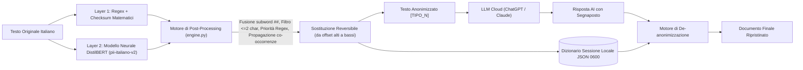

<div align="center">


# Omissis — `pii-italiano-v2`

**Sistema Ibrido Open-Source di Rilevamento e Pseudonimizzazione Reversibile PII per la Lingua Italiana**

[](#stack-e-framework-utilizzati)
[](#stack-e-framework-utilizzati)
[](#specifiche-tecniche-del-modello-pii-italiano-v2)
[](#architettura-del-sistema)
[-0.980-10B981)](#metriche-e-benchmark-di-validazione)
[](#sicurezza-e-privacy-by-design)

</div>

---

## Indice

1. [Panoramica del Progetto](#panoramica-del-progetto)
2. [Architettura del Sistema Ibrido](#architettura-del-sistema-ibrido)
3. [Specifiche Tecniche del Modello (`pii-italiano-v2`)](#specifiche-tecniche-del-modello-pii-italiano-v2)
4. [Le 49 Categorie PII + 5 Regole Matematiche](#le-49-categorie-pii--5-regole-matematiche)
5. [Metriche e Benchmark di Validazione](#metriche-e-benchmark-di-validazione)
6. [Motore di Post-Processing e Pseudonimizzazione Reversibile](#motore-di-post-processing-e-pseudonimizzazione-reversibile)
7. [Confronto Tecnico: `pii-italiano-v2` vs `rizzo-pii · 0.3B`](#confronto-tecnico-pii-italiano-v2-vs-rizzo-pii--03b)
8. [Stack e Framework Utilizzati](#stack-e-framework-utilizzati)
9. [Installazione e Avvio con un Solo Comando](#installazione-e-avvio-con-un-solo-comando)
10. [Sicurezza, Privacy by Design e Limiti Noti](#sicurezza-privacy-by-design-e-limiti-noti)

---

## Panoramica del Progetto

**Omissis** è una piattaforma locale di **pseudonimizzazione reversibile** progettata per proteggere documenti, contratti, email e atti in lingua italiana prima di sottoporli a modelli linguistici cloud (come ChatGPT, Claude o Gemini).

Il flusso operativo si articola in 4 passaggi interamente eseguiti su `127.0.0.1`:
1. **Rilevamento Ibrido**: Il testo viene analizzato in parallelo da uno **strato deterministico Regex con verifica matematica del checksum** e da un **modello neurale `DistilBertForTokenClassification`** (`pii-italiano-v2`).
2. **Mascheramento Reversibile**: Ogni entità distinta viene sostituita con un segnaposto tipizzato e numerato (`[FIRSTNAME_1]`, `[FIRSTNAME_2]`, `[CODICE_FISCALE_1]`, `[IBAN_1]`), garantendo che la stessa entità ripetuta a distanza nel testo riceva sempre lo stesso segnaposto per preservare la coerenza semantica e coreferenziale.
3. **Interazione Sicura con gli LLM Cloud**: L'utente copia il testo anonimizzato nell'LLM esterno senza mai esporre dati personali reali (GDPR / EU AI Act compliance).
4. **De-anonimizzazione Intelligente**: Incollando la risposta dell'LLM in Omissis, il motore ripristina i valori originali in chiaro a partire dal dizionario di sessione locale (`0600`), tollerando riformattazioni di spazi o maiuscole/minuscole operate dal modello esterno.

---

## Architettura del Sistema Ibrido



---

## Specifiche Tecniche del Modello (`pii-italiano-v2`)

Il modello neurale `pii-italiano-v2` è un encoder transformer specializzato nel **Token Classification (NER / PII Detection)** multilingue con focus sull'italiano:

| Parametro Tecnico | Valore / Specifica |
| :--- | :--- |
| **Architettura** | `DistilBertForTokenClassification` (`distilbert`) |
| **Modello Base (Backbone)** | `distilbert-base-multilingual-cased` |
| **Dimensione Pesi (`model.safetensors`)** | `539.25 MB` (`float32`, ~135 Milioni di parametri) |
| **Strati (Layers) / Teste di Attenzione** | `6` Transformer Layers • `12` Attention Heads |
| **Dimensione Hidden / Feed-Forward** | `dim = 768` • `hidden_dim = 3072` • Attivazione `gelu` |
| **Lunghezza Massima Contesto** | `512` posizioni (`max_position_embeddings = 512`) |
| **Tokenizer** | `BertTokenizer` (WordPiece cased, `do_lower_case = false`) |
| **Dimensione Vocabolario** | `119.547` token (`tokenizer.json` da `2.92 MB`) |
| **Classi BIO Totali** | `99` classi (`49` prefissi `B-`, `49` prefissi `I-`, `1` classe `O`) |
| **Dataset di Addestramento** | `198.797` esempi • `3` epoche di training |
| **Dropout** | `dropout = 0.1`, `attention_dropout = 0.1`, `seq_classif_dropout = 0.2` |

---

## Le 49 Categorie PII + 5 Regole Matematiche

### Strato 1 — Rilevamento Deterministico con Verifica Matematica del Checksum (`fonte = 'regex'`)
Lo strato deterministico in `pii_ibrido.py` ha **sempre priorità assoluta** sul modello neurale e azzera i falsi positivi validando matematicamente ogni codice:

| Categoria | Pattern & Algoritmo di Validazione |
| :--- | :--- |
| **`CODICE_FISCALE`** | Regex 16 caratteri alfanumerici + **calcolo del carattere di controllo dispari/pari mod 26 (`cf_ok`)** secondo il D.M. 12/03/1974. |
| **`IBAN`** | Regex internazionale (`[A-Z]{2}[0-9]{2}[A-Z0-9]{11,30}`) + **verifica aritmetica ISO 13616 Modulo 97 (`iban_ok`, resto `== 1`)**. |
| **`PARTITA_IVA`** | Regex 11 cifre numeriche + **algoritmo di controllo pari/dispari su base 10 (`piva_ok`)**. |
| **`CARTA_CREDITO`** | Sequenze da 13 a 19 cifre (con spazi o trattini) + **validazione con Algoritmo di Luhn (`luhn`)**. |
| **`EMAIL`** | Pattern RFC standard per indirizzi di posta elettronica. |

### Strato 2 — Le 49 Categorie Neurali (`B-` / `I-` in `config.json`)
Il modello neurale copre il testo libero e le entità non strutturate attraverso 49 tipi distinti:

- **Identità e Persona**: `FIRSTNAME`, `MIDDLENAME`, `LASTNAME`, `PREFIX`, `AGE`, `GENDER`, `HEIGHT`, `EYECOLOR`, `DATE`, `TIME`
- **Indirizzi e Geolocalizzazione**: `STREET`, `BUILDINGNUMBER`, `SECONDARYADDRESS`, `CITY`, `COUNTY`, `STATE`, `ZIPCODE`, `NEARBYGPSCOORDINATE`, `ORDINALDIRECTION`
- **Finanza e Criptovalute**: `ACCOUNTNAME`, `ACCOUNTNUMBER`, `IBAN`, `BIC`, `CREDITCARDNUMBER`, `CREDITCARDCVV`, `CREDITCARDISSUER`, `AMOUNT`, `CURRENCY`, `BITCOINADDRESS`, `ETHEREUMADDRESS`, `LITECOINADDRESS`
- **Contatti, Lavoro e Identificativi**: `PHONENUMBER`, `PHONEIMEI`, `EMAIL`, `SSN`, `COMPANYNAME`, `JOBAREA`, `JOBTITLE`, `JOBTYPE`, `VEHICLEVIN`, `VEHICLEVRM`
- **Credenziali e Rete**: `USERNAME`, `PASSWORD`, `PIN`, `MASKEDNUMBER`, `URL`, `IPADDRESS`, `MAC`, `USERAGENT`

---

## Metriche e Benchmark di Validazione

Dai dati ufficiali di validazione del modello (`info_modello.json`) e dai benchmark eseguiti localmente su CPU:

### Accuratezza Globale e per Lingua
| Metrica / Lingua | Valore |
| :--- | :--- |
| **Precision (Globale)** | **97.42%** (`0.9742`) |
| **Recall (Globale)** | **98.01%** (`0.9801`) |
| **F1-Score (Globale)** | **97.71%** (`0.9771`) |
| **F1-Score Italiano (`it`)** | **98.00%** (`0.980`) |
| **F1-Score Francese (`fr`)** | **98.00%** (`0.980`) |
| **F1-Score Tedesco (`de`)** | **97.60%** (`0.976`) |
| **F1-Score Inglese (`en`)** | **97.00%** (`0.970`) |

### Latenza di Inferenza
| Ambiente di Esecuzione | Latenza Media per Frase |
| :--- | :--- |
| **GPU NVIDIA A100** | `6.96 ms` |
| **CPU Riferimento (`info_modello.json`)** | `27.28 ms` |
| **CPU Locale Windows (Python 3.11 + PyTorch 2.14 CPU)** | **`21.6 ms`** (caricamento a freddo dei pesi: `1.19 s`) |

---

## Motore di Post-Processing e Pseudonimizzazione Reversibile

Il modulo [`engine.py`](engine.py) risolve i limiti strutturali del tokenizer WordPiece e della pipeline base:

1. **Ricomposizione dei subword spezzati (`##`)**:
   - I toponimi o cognomi italiani meno frequenti possono essere spezzati dal tokenizer in più sub-token con etichette discordanti (es. `"Palestrina"` $\rightarrow$ `CITY="Pale"` + `STATE="##strina"`).
   - [`post_processa_rilevamenti()`](engine.py) rimuove i prefissi `##` e fonde automaticamente gli span adiacenti o sovrapposti che appartengono alla stessa parola continua.
2. **Filtro anti-rumore e Precedenza Deterministica**:
   - Tutti i rilevamenti di `1–2` caratteri provenienti dal modello neurale (es. sigle o preposizioni ambigue) vengono scartati, mentre vengono preservati se provengono dallo strato `regex`.
   - In caso di sovrapposizione parziale o totale, lo strato `fonte='regex'` vince sempre su `fonte='modello'`.
3. **Propagazione Intra-Documento delle Entità**:
   - Se un nome proprio (es. `"Marco"`) viene riconosciuto dal modello in una frase ma omesso in un'altra frase dello stesso testo, il motore propaga automaticamente il rilevamento su tutte le occorrenze a parola intera (case-insensitive).
4. **Sostituzione Reversibile da Offset Alti a Bassi**:
   - Ogni valore distinto riceve un segnaposto numerato progressivo per categoria (`[FIRSTNAME_1]`, `[FIRSTNAME_2]`, `[IBAN_1]`).
   - La sostituzione avviene partendo dagli **offset di carattere più alti verso i più bassi**, mantenendo intatti gli indici di inizio/fine di tutte le entità precedenti.
5. **De-anonimizzazione Tollerante e Verifica di Integrità**:
   - [`deanonimizza_testo()`](engine.py) effettua il matching canonico ignorando differenze di maiuscole/minuscole, spazi extra o trattini inseriti dall'LLM (es. `[ firstname_1 ]` o `[FIRSTNAME 1]`).
   - Segnala visivamente sia i **segnaposto sconosciuti** (presenti nella risposta AI ma assenti nella sessione) sia i **segnaposto mancanti** (presenti nella sessione ma omessi dall'AI).

---

## Confronto Tecnico: `pii-italiano-v2` vs `rizzo-pii · 0.3B`

| Caratteristica | Omissis (`pii-italiano-v2` + [`engine.py`](engine.py)) | `rizzo-pii · 0.3B` (Rizzo AI Academy) |
| :--- | :--- | :--- |
| **Architettura Backbone** | **DistilBERT** (`distilbert-base-multilingual-cased`) | **ModernBERT** (`mmBERT` encoder) |
| **Parametri e Peso** | **~135M parametri** (~0.13B) • `539 MB` (`fp32`) | **~307M parametri** (~0.3B) • ~615 MB (`bf16`) / ~1.2 GB (`fp32`) |
| **Finestra di Contesto** | `512` token | Fino a `8.192` token |
| **Latenza su CPU** | **~21–27 ms / frase** (6 layer, leggerissimo su qualsiasi CPU) | **~60–150 ms / frase** (~2.2x parametri) |
| **Validazione Codici Italiani (CF, P.IVA, IBAN, Carte)** | **Ibrida Deterministica**: Regex + **verifica matematica del checksum** (`cf_ok`, `iban_ok`, `piva_ok`, `luhn`) con zero falsi positivi | **Principalmente Neurale** (token-classification addestrato sui tag `CF`, `PIVA`, `IBAN`, `CATASTO`, `DOCID`) |
| **Categorie Supportate** | **49 classi PII** + 5 validatori matematici | **22 categorie** focalizzate su ambito legale/notarile/medico |
| **F1-Score Italiano** | **0.980** | **~0.989** (su dataset legale italiano) |

---

## Stack e Framework Utilizzati

- **Runtime**: Python `3.10–3.13` (testato e certificato su `Python 3.11.9` 64-bit).
- **Deep Learning & NLP**:
  - `torch` (`2.14.1+cpu` dall'indice ufficiale CPU-only `https://download.pytorch.org/whl/cpu` per evitare i 2,5 GB di dipendenze CUDA inutilizzate).
  - `transformers` (`5.20.1`) + `safetensors` (`0.8.0`) + `tokenizers` (`0.23.3`).
- **Backend Web**:
  - `fastapi` (`0.143.3`) + `uvicorn[standard]` (`0.54.0`) + `pydantic` (`2.14.1`).
  - Caricamento **singleton** del modello nel ciclo `lifespan` all'avvio del server.
- **Frontend (`index.html`)**:
  - Single-Page Application in **HTML5 + Vanilla JavaScript + CSS3 Glassmorphism inline**, senza build step, senza framework JS esterni e senza alcuna CDN.

---

## Installazione e Avvio con un Solo Comando

Clona la repository ed esegui **un unico comando**:

```bash
python omissis.py
```

*(Su Windows puoi anche fare doppio clic su **`avvia.bat`**).*

Lo script [`omissis.py`](omissis.py) automatizza l'intero ciclo di vita:
1. Crea l'ambiente virtuale `venv/` se non esiste.
2. Installa nell'ordine rigoroso `pip`, `torch` (CPU-only) e `transformers fastapi "uvicorn[standard]"`.
3. Cerca automaticamente la cartella del modello `pii-italiano-v2` (o l'archivio `pii-italiano-v2.zip`), corregge eventuali cartelle annidate (`pii-italiano-v2/pii-italiano-v2`) oppure la scarica tramite `--model-url <URL_ZIP>` o `--hf-repo <UTENTE/REPO>`.
4. Avvia il server su `http://127.0.0.1:8000` e apre automaticamente il browser.

### Esecuzione dei Test Automatici
```bash
# Verifica del modello sulle 3 frasi di benchmark (Fase 2)
./venv/Scripts/python.exe verify_model.py

# Test di round-trip completo: testo -> anonimizza -> de-anonimizza == originale (Fase 4)
./venv/Scripts/python.exe test_roundtrip.py
```

---

## Sicurezza, Privacy by Design e Limiti Noti

### Sicurezza Non Negoziabile
- **Binding esclusivo su `127.0.0.1`**: Il server non ascolta mai su `0.0.0.0`, rendendo impossibile l'accesso da altri dispositivi sulla rete locale.
- **Zero traffico di rete in uscita**: Nessun dato lascia la macchina durante l'analisi; nessun font, script o foglio di stile viene caricato da CDN esterne.
- **Protezione del dizionario di sessione (`0600`)**: Il file `sessions_data.json` contiene la mappatura in chiaro tra segnaposto e dati reali per consentire il ripristino anche dopo il riavvio dell'applicazione. Viene salvato con permessi **`0600`** (lettura/scrittura riservata esclusivamente all'utente proprietario tramite `os.chmod` e `icacls` su Windows) ed è escluso dal versionamento tramite [`.gitignore`](.gitignore).

### Limiti Noti
> **Avvertenza importante**: Il testo anonimizzato **va sempre riletto prima di incollarlo su servizi esterni**. Il modello neurale presenta un'accuratezza F1 del `98.0%` sull'italiano, il che significa che **può perdersi circa il 2% delle entità** su dati simili a quelli di addestramento, e **una percentuale maggiore su testo reale** (nomi insoliti, refusi, indirizzi non standard o contesti oltre i 512 token).
